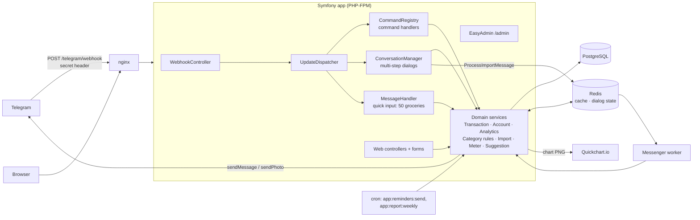

# Architecture

Family Finance Manager is one Symfony application with two interfaces: a Telegram bot for daily input and a web
dashboard for planning and review. Both call the same domain services and share one PostgreSQL database.

## Layers

| Directory | Responsibility |
|---|---|
| `src/Domain/` | Business logic without HTTP or Telegram code: balances, monthly reports and trends, keyword/IBAN category rules, statement parsing and deduplication, meter consumption, recommendations |
| `src/Telegram/` | Update dispatcher, command registry and handlers, conversation state machine, sender (logs replies instead of calling the API when no bot token is set) |
| `src/Controller/` | `Web/` dashboard pages, `Admin/` EasyAdmin CRUD, `Telegram/` webhook entry point |
| `src/Message/`, `src/MessageHandler/` | Messenger messages: bank imports run in the worker; reminders, notifications and report generation |
| `src/Command/` | Console commands: create user, set webhook, send due reminders, weekly report |
| `src/Entity/`, `src/Repository/` | Doctrine entities with UUID keys, backed enums, family-scoped queries |

## Data model

Everything belongs to a `Family`. Members (`User`) share its accounts, categories, budgets, savings goals,
transactions and meter readings, and every repository query is scoped by family. A user becomes a bot user when
`telegramChatId` is set during `/start` registration.

- `Transaction` has a type (expense, income, transfer, refund, adjustment), a source and/or target `Account` and an
  optional `Category`. Account balances are the initial balance plus inflows minus outflows and are cached in Redis
  until a transaction touches the account.
- `ImportFile` → `ImportTransaction`: parsed statement rows. Each row carries a SHA-256 hash of its key fields, so
  importing the same statement twice skips known rows. Rows matched by a `CategoryRule` are imported directly, the
  rest wait in the `/pending` queue.
- `Budget` is planned spending per category and month, `SavingsGoal` a target amount on a savings account,
  `MeterReading` an electricity (kWh) or water (m³) reading; consumption is the delta to the previous reading.
- `ReminderTemplate` defines daily, weekly or monthly reminders sent via Telegram and/or e-mail; a template without a
  family applies to all families.

## Request flows

**Bot update.** Telegram calls the webhook with the `X-Telegram-Bot-Api-Secret-Token` header; anything else gets 403.
`UpdateDispatcher` sets the reply language from the sender's Telegram language and routes the update: callback
buttons to their handler, text into an active conversation (state in Redis, 30-minute TTL, `/cancel` ends it),
slash commands to the `CommandRegistry`, and free text to quick input, which parses an amount and description,
guesses the category from the family's rules and books an expense on the default account.

**Bank import.** `/import` starts a conversation that downloads the file, detects MT940 or Sparkasse CSV and
dispatches `ProcessImportMessage`. The worker parses, deduplicates and categorises the rows and reports the result
back to the chat.

**Web.** Form login with CSRF protection, `ROLE_USER` for the dashboard and `ROLE_ADMIN` for `/admin`. Assets are
served by AssetMapper: Tailwind CSS is compiled by the Tailwind standalone binary and Chart.js comes from the
importmap, so there is no Node build and no CDN at runtime. Charts are declared as `data-chart` attributes and
rendered by `assets/app.js`. The UI language (English, German, Russian) is stored in the session.

## Design decisions

- **Dialog state in Redis, not in the database.** Steps are short-lived; an abandoned dialog expires on its own.
  Losing state on a Redis restart is acceptable for a household tool.
- **Cron instead of a scheduler process.** One hourly `app:reminders:send` run is enough; `ReminderTemplate::isDue()`
  holds the timing rules and is unit tested.
- **Quickchart.io for bot charts.** Telegram can only show images, so the bot renders Chart.js configurations to PNG
  through Quickchart (self-hostable); the web dashboard renders the same kind of chart in the browser.
- **EasyAdmin for rare operations** such as reminder templates and families, instead of custom admin pages.
