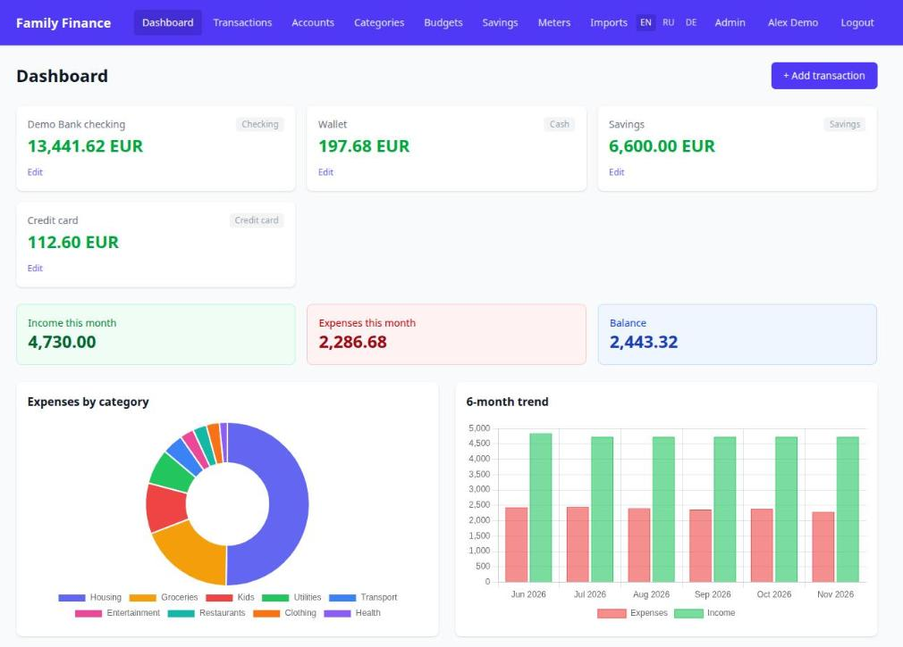
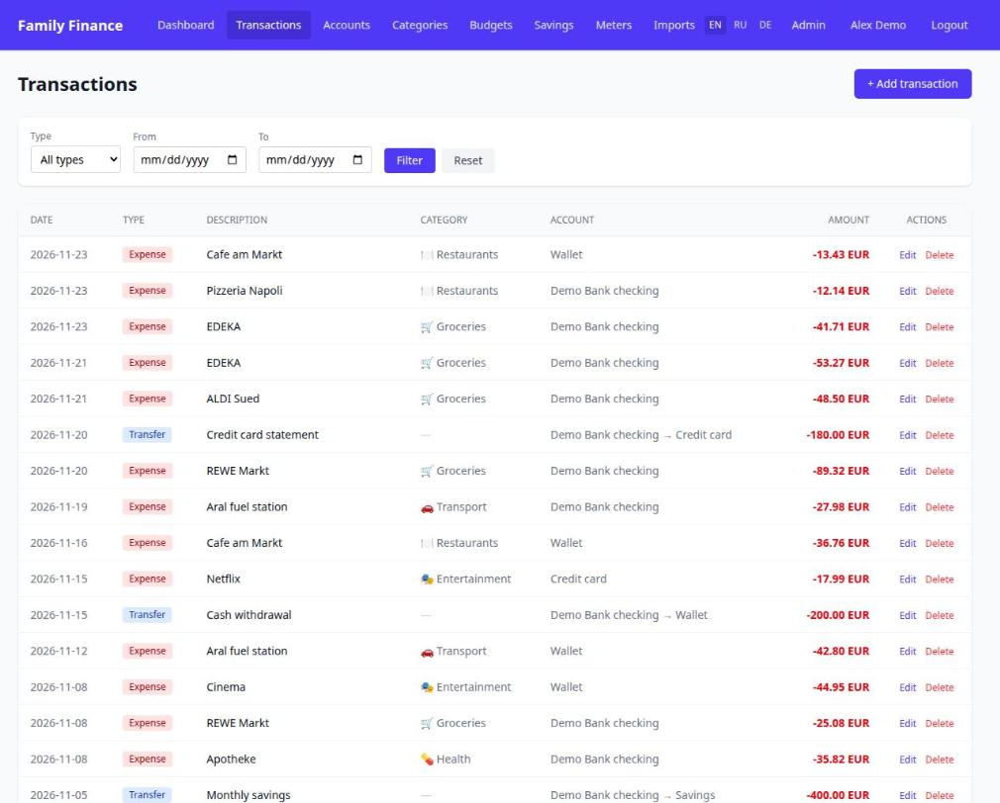
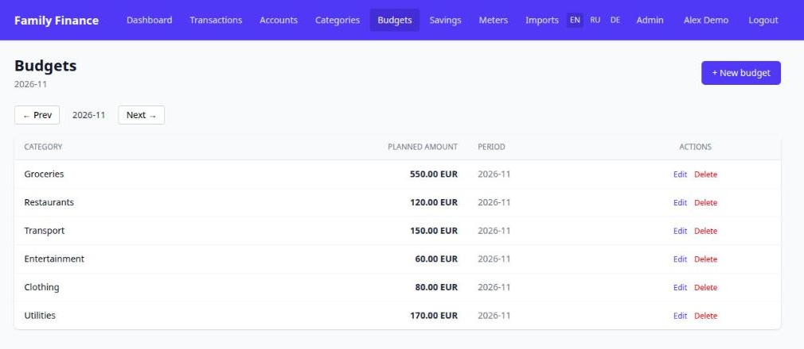
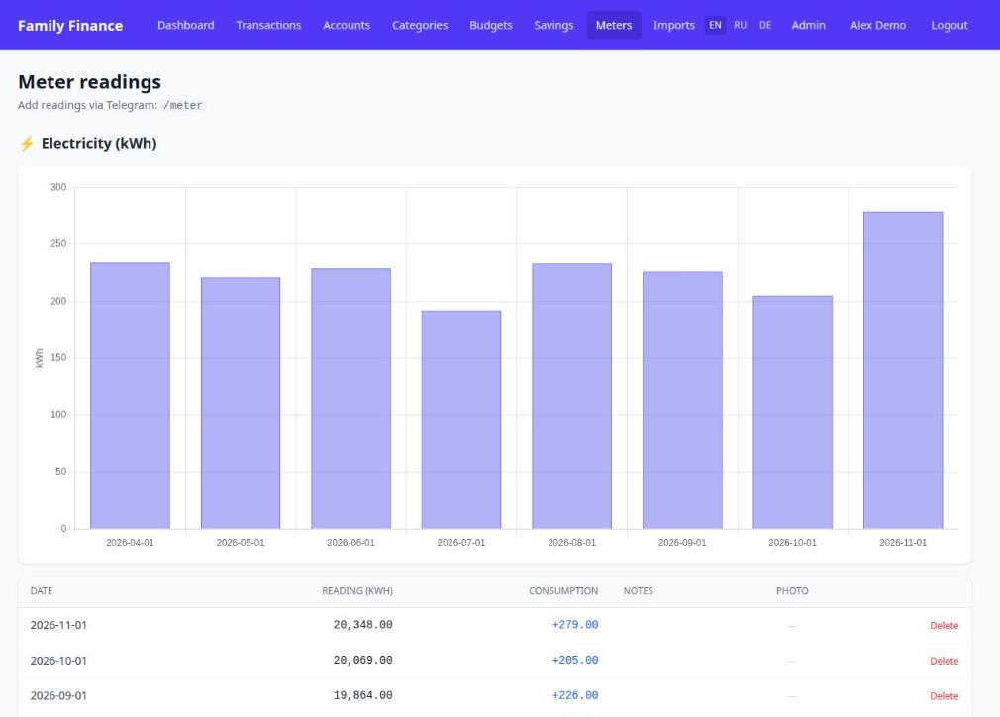
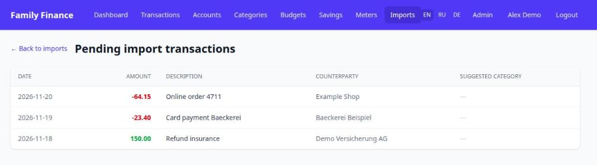
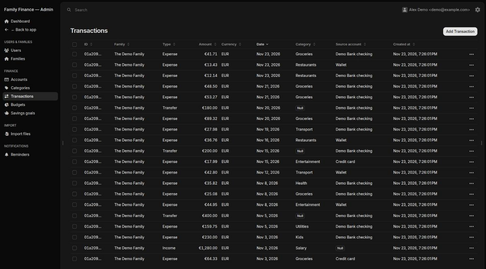
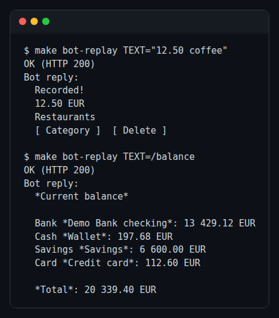
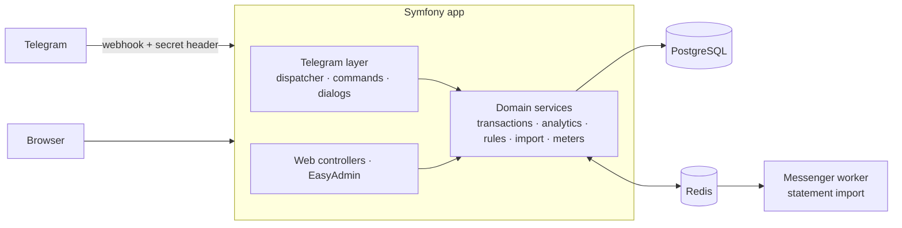

# Family Finance Manager

[](https://github.com/okarabudka/family-finance-manager/actions/workflows/ci.yml)

A self-hosted finance tracker for one household. Family members record expenses from Telegram in a few seconds
(`12.50 coffee`), import their bank statements, and plan budgets and savings goals in a web dashboard with charts.
`make up` starts the whole stack in Docker with a demo family, so there is something to look at right away.



## Why it exists

My family wanted one place for our money: card payments, cash, two salaries, savings, and the electricity and water
meters we have to report every month. Banking apps show one account each, and spreadsheets are not something you open
at the supermarket checkout. A Telegram chat is: it is always open, works for every family member, and needs no app
install.

So the bot is the main interface for daily input and the web dashboard is for the monthly review. Both use the same
domain services, which keeps the bot thin and the business rules testable.

## What you get

**A bot for daily input.** `/start` registers a chat and links it to a family. Typing `50 groceries` books an expense
on the default account and guesses the category from keyword and IBAN rules; inline buttons change the category or
delete the booking. Guided dialogs cover expenses, income, transfers, meter readings and statement imports. `/balance`,
`/report`, `/stats` (chart image) and `/budget` answer questions on the go. The bot replies in English, German or
Russian, depending on the sender's Telegram language.

**Bank statement import.** MT940 (`.sta`) and Sparkasse CSV files are parsed in a Messenger worker. Each row gets a
SHA-256 fingerprint, so importing the same statement twice adds nothing. Rows that match a category rule are booked
directly, the rest wait in a review queue (`/pending` in the bot, *Imports* on the web).

**A dashboard for the monthly review.** Account balances, income and expenses of the month, spending by category, a
six-month trend, budget usage and recommendations (unusual increases, exceeded budgets, expenses above income).
Transactions can be filtered and edited; accounts, hierarchical categories, budgets, savings goals and meter readings
with consumption charts each have their own page. The UI is available in English, German and Russian.

**Reminders and reports.** Reminder templates (daily, weekly or monthly) go out via Telegram and/or e-mail, for
example "submit the electricity reading on the 1st". A weekly report is sent to every family member.

**An admin panel** at `/admin` (EasyAdmin) for users, families, reminder templates and all other entities.

**Quality checks on every push.** Unit, integration and functional tests against PostgreSQL, PHPStan at level max
with the Symfony, Doctrine and PHPUnit extensions (tests included), PHP CS Fixer, a smoke test of the Docker stack and
a gitleaks scan of the full history.

## Screenshots

| | |
|---|---|
|  |  |
| Transactions with filters | Budgets per category and month |
|  |  |
| Meter readings with consumption charts | Imported bank transactions waiting for review |
|  |  |
| EasyAdmin panel | Telegram bot, replayed locally with `make bot-replay` |

## Tech stack

- PHP 8.5, Symfony 8.1, Doctrine ORM 3, EasyAdmin 5
- PostgreSQL 16, Redis 7 (cache, dialog state, Messenger transport), Symfony Messenger worker
- Twig, Tailwind CSS 4 and Chart.js through AssetMapper: no Node build, no CDN
- Telegram Bot API via webhook, Quickchart.io for chart images in the bot, League CSV
- Docker Compose (PHP-FPM, nginx, PostgreSQL, Redis, worker, Mailpit)
- PHPUnit 13, PHPStan (level max), PHP CS Fixer, GitHub Actions

## Architecture



- `src/Domain/` — business logic without HTTP or Telegram code.
- `src/Telegram/` — update dispatcher, command handlers and the conversation state machine (state in Redis).
- `src/Controller/` — web pages, EasyAdmin CRUD and the webhook entry point.
- `src/Message*/`, `src/Command/` — background jobs and console commands for reminders and reports.

Request flows, the data model and design decisions are described in [ARCHITECTURE.md](ARCHITECTURE.md).

## Getting started

You need Docker with Docker Compose and make. PHP, Composer and Node are not required on your machine.

```bash
git clone https://github.com/okarabudka/family-finance-manager.git
cd family-finance-manager
make up
```

`make up` builds the PHP 8.5 image, starts all containers and waits for their healthchecks, installs Composer
dependencies, runs the migrations, builds the Tailwind CSS and loads the demo data into an empty database. Then open:

| What        | Address                                  |
|-------------|------------------------------------------|
| Web app     | http://localhost:8080                    |
| Admin panel | http://localhost:8080/admin              |
| Mailpit     | http://localhost:8025 (reminder e-mails) |

Demo login (local demo only): `demo@example.com` / `demo-password`. The demo family has four accounts, six months of
transactions, budgets, savings goals, meter readings and a bank import with rows waiting for review. All names, IBANs
and amounts are made up.

If a port is taken, start with `make up APP_PORT=8081 MAILPIT_PORT=8026`.

### Try the bot without Telegram

With an empty `TELEGRAM_BOT_TOKEN` (the default) the bot works offline: the webhook accepts updates as usual and
replies are written to the log instead of being sent. `make bot-replay` posts a recorded Telegram update
([`tests/Fixtures/telegram/message.json`](tests/Fixtures/telegram/message.json)) from the demo user's chat and prints
the bot's answer:

```bash
make bot-replay TEXT=/balance
make bot-replay TEXT="12.50 coffee"    # books an expense, visible under Transactions
make bot-replay TEXT=/help
```

The same request with curl:

```bash
sed 's|__TEXT__|/report|' tests/Fixtures/telegram/message.json | curl -X POST http://localhost:8080/telegram/webhook \
  -H 'Content-Type: application/json' -H 'X-Telegram-Bot-Api-Secret-Token: dev-webhook-secret' --data-binary @-
docker compose logs app | grep 'Telegram reply'
```

### Connect a real bot

Create a bot with [@BotFather](https://t.me/BotFather), then put the values into `.env.local` (git-ignored):

```dotenv
TELEGRAM_BOT_TOKEN=<token from BotFather>
TELEGRAM_WEBHOOK_URL=https://<public host>/telegram/webhook
TELEGRAM_WEBHOOK_SECRET=<long random string>
```

Telegram needs a public HTTPS URL; for local development a tunnel such as ngrok works. Register the webhook with
`make set-webhook` and send `/start` to the bot.

### Day-to-day commands

| Command              | What it does                                                    |
|----------------------|-----------------------------------------------------------------|
| `make up`            | Build and start the stack, migrate, seed an empty database      |
| `make down`          | Stop the containers (volumes are kept)                          |
| `make fixtures`      | Reset the database to the demo data                             |
| `make test`          | Recreate the test database and run all tests                    |
| `make coverage`      | Tests with a coverage report in `var/coverage`                  |
| `make stan`          | PHPStan, level max                                              |
| `make cs` / `cs-fix` | Check / fix the coding standard                                 |
| `make qa`            | `cs`, `stan` and `test`, like CI                                |
| `make bot-replay`    | Send a recorded Telegram update to the local webhook            |
| `make shell`         | Shell in the PHP container                                      |
| `make help`          | List all targets                                                |

### Production

`docker-compose.prod.yml` runs the `prod` and `nginx` targets of `docker/php/Dockerfile`: Composer without dev
packages and an authoritative class map, Tailwind and the asset map compiled at build time and served by nginx with
immutable cache headers, healthchecks for every service. Secrets come from a git-ignored `.env.prod`:

```bash
docker compose -f docker-compose.prod.yml --env-file .env.prod up -d --build --wait
docker compose -f docker-compose.prod.yml --env-file .env.prod exec app php bin/console doctrine:migrations:migrate
```

Schedule `app:reminders:send` hourly, `app:report:weekly` weekly and `scripts/backup.sh` daily with cron on the host.
`.github/workflows/deploy.yml` is a manually triggered example that pushes both images to GHCR and rolls them out over
SSH.

## Testing

```bash
make test
```

| Suite         | What it covers                                                                                                   |
|---------------|------------------------------------------------------------------------------------------------------------------|
| `unit`        | Domain services: balances, transactions, quick input parser, category rules, MT940 and Sparkasse parsers, import processing, recommendations, meters, reminder schedule |
| `integration` | Repository queries (sums per account, category and period) against PostgreSQL                                    |
| `functional`  | `WebTestCase`: login, every page of the demo user, creating a transaction, the Telegram webhook (403 on a wrong or missing secret, 200 for a recorded update, quick input booking an expense) |

Functional and integration tests run against a PostgreSQL test database with the demo data; DAMADoctrineTestBundle
wraps every test in a transaction that is rolled back. The Telegram API is never called in tests.

CI (`.github/workflows/ci.yml`) runs on every push and pull request:

| Job       | What it checks                                                                                 |
|-----------|------------------------------------------------------------------------------------------------|
| `quality` | composer validate, PHP CS Fixer, PHPStan (max), container/Twig/YAML/translation lint            |
| `tests`   | All suites with a PostgreSQL service; the coverage report is uploaded as an artifact            |
| `smoke`   | `make up`, then login page, demo login, dashboard with chart data and a bot replay with curl    |
| `secrets` | gitleaks over the full history                                                                 |

## Status

Maintained.

## License

MIT, see [LICENSE](LICENSE).
